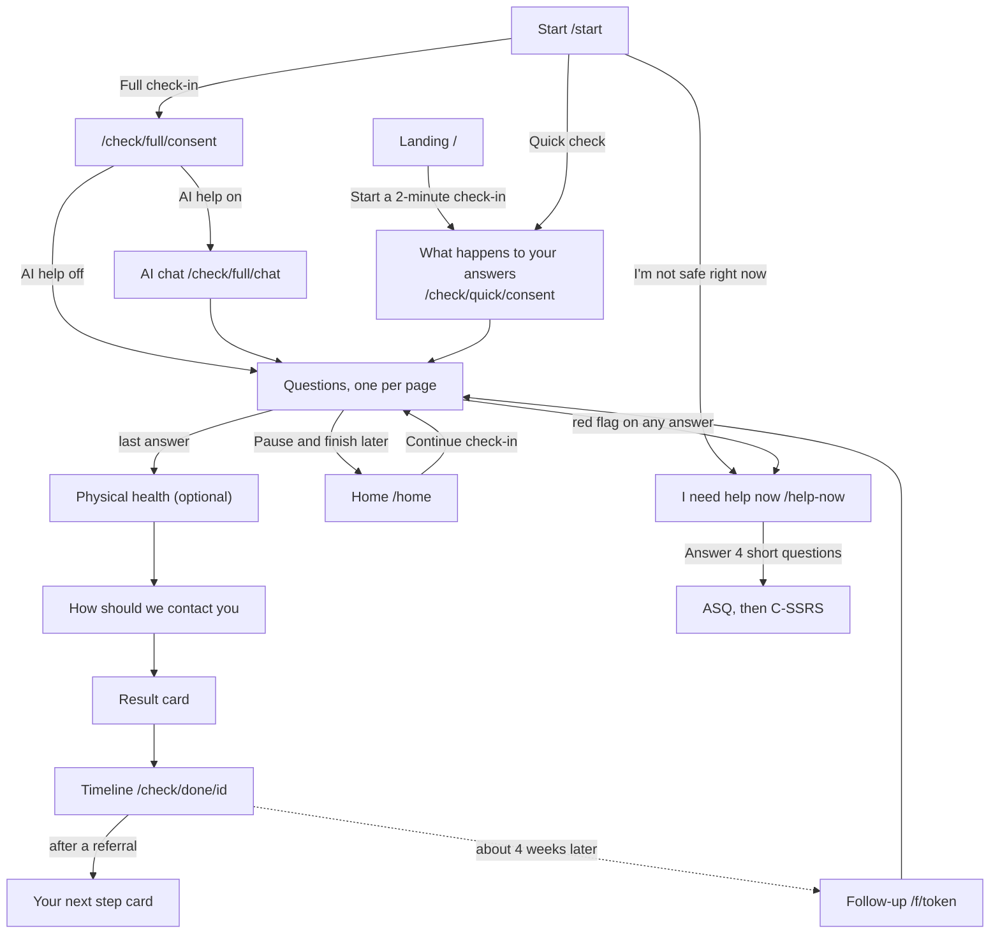
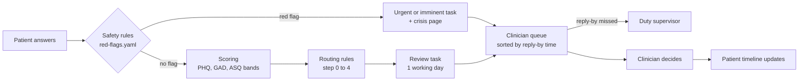
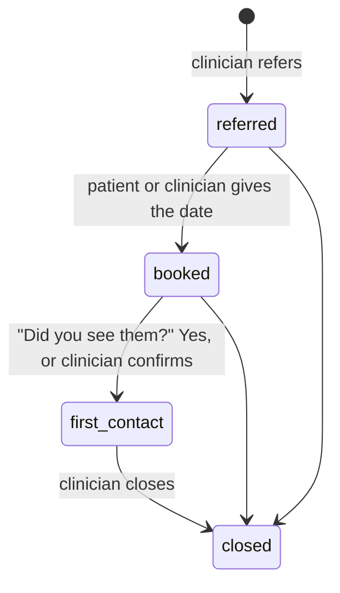

# Borderless: features and workflow

Borderless is a non-diagnostic mental health intake, triage and follow-up prototype, built for the Future Health Digital Innovation Challenge 2026.

A person answers a few short, standard questions. Fixed safety rules check every answer. A licensed clinician reads every check-in and decides the next step. The person always sees when they will hear back, and the service follows through until they have actually been seen.

> **Status:** working prototype with synthetic demo data. Clinical rules marked DRAFT need psychiatrist sign-off. Data is processed outside the UAE (see [Data and hosting](#9-data-hosting-and-privacy)).

---

## Contents

1. [Principles](#1-principles)
2. [Who uses it](#2-who-uses-it)
3. [Patient workflow](#3-patient-workflow)
4. [Every patient page](#4-every-patient-page)
5. [The safety engine](#5-the-safety-engine)
6. [Clinician console](#6-clinician-console)
7. [Referral follow-through (hand-off)](#7-referral-follow-through-hand-off)
8. [Consent](#8-consent)
9. [Data, hosting and privacy](#9-data-hosting-and-privacy)
10. [Service overview and outcomes](#10-service-overview-and-outcomes)
11. [Live demo and clinic embed](#11-live-demo-and-clinic-embed)
12. [Configuration files](#12-configuration-files)
13. [Architecture](#13-architecture)
14. [Testing](#14-testing)
15. [Limits and next steps](#15-limits-and-next-steps)
16. [Glossary](#16-glossary)

---

## 1. Principles

| Principle | What it means in the product |
|---|---|
| **Rules, not AI, decide risk** | Scores, red flags, urgency and routing come from plain rule files a psychiatrist can read. The AI only helps people answer, and is never called again after a red flag. |
| **Nobody waits in silence** | Every case has a reply-by time. The patient sees it on their timeline; late cases go to the duty supervisor automatically. |
| **Help is always one tap away** | "I need help now" and "Talk to someone" are on every patient page, in the same place. Quick exit is in every header. |
| **The person controls sharing** | Separate, revocable choices for each purpose. Every change is logged. Never shared with an employer. |
| **Screening, not diagnosis** | Every score is labelled "screening score, not a diagnosis". No diagnosis labels anywhere. |
| **Follow through** | A referral isn't the end: the service checks the person booked and was seen. |

---

## 2. Who uses it

| User | How they get in | What they do |
|---|---|---|
| **Patient** | `/` or `/start`. No account; a browser cookie links them to their check-in. | Checks in, sees results and timeline, uses coping cards, talks to the team. |
| **Clinician** | `/staff/login` | Reviews the queue, decides next steps, contacts and refers people. |
| **Duty supervisor** | `/staff/login` | Same powers; responsible for cases that run late (the Escalated view). |
| **Judge** | `/staff/login` | View-only access to everything. |
| **Employer or university** | Links to the check-in from their website | Sees totals only, never a person, with a minimum group size of 10. |

Demo staff accounts: `clinician@borderless.demo`, `supervisor@borderless.demo`, `judge@borderless.demo`. The password is kept out of this file.

---

## 3. Patient workflow

### The three paths

| Path | Questions | Time |
|---|---|---|
| **Quick check** | PHQ-2 (mood), GAD-2 (worry), one suicide question | About 2 minutes |
| **Full check-in** | Optional AI conversation, then PHQ-9 and GAD-7 | About 10 minutes |
| **Crisis ("I'm not safe right now")** | Emergency numbers first; optional ASQ, then C-SSRS if positive | Immediate |

A **follow-up** about 4 weeks later repeats PHQ-9 and GAD-7 so change can be measured.

---

## 4. Every patient page

| Page | What it shows | Where it leads |
|---|---|---|
| `/` Landing | Headline, how it works (5 steps), reply-time targets, why it's safe, coping cards, clinician preview | Start a 2-minute check-in, live demo, care team sign-in, Privacy / Terms / Accessibility / Contact |
| `/start` | Three options, emergency first | Crisis page, quick check, full check-in, "Coming back?" |
| `/check/[path]/consent` | "What happens to your answers": four promises, care-team access (needed), AI help (full check-in only) | First question, or the AI chat |
| `/check/full/chat` | AI assistant asks about what's going on. Every message is phrase-checked before and after the AI. | Questions, or the crisis page if unsafe |
| `/check/[path]/1..n` | One question per page, section count, "Why am I asked this?", gentle note before suicide questions | Next question; crisis page on a red flag |
| ↳ Prefer not to say | On non-safety questions only. The questionnaire then gets no score. | Next question |
| ↳ Pause and finish later | Keeps the check-in for 7 days on this device | Home, with "Continue check-in" |
| `/check/[path]/health` | Optional: share physical health with the care team; share a summary with the family doctor | Contact page |
| `/check/[path]/contact` | Phone / SMS / WhatsApp / email, safe times, voicemail OK, discreet message preview | Result card |
| `/check/[path]/result` | Each score in plain words, "screening score, not a diagnosis", what happens next; choices for follow-up and anonymous statistics; optional About you | Timeline, support options, full check-in offer |
| `/check/done/[id]` Timeline | Sent → reviewed → next step → referred → booked → first contact. Messages with the care team. Your next step card. Picked-for-you coping card. How did that feel? | Coping cards, guides, support options, data page |
| `/help-now` | 998, 999 and 800-SAKINA first. No waiting, no AI. | Alert my care team now, breathing, optional safety questions |
| `/talk` | Talk to someone (not urgent) | Request a call back; message the care team; 24/7 line |
| `/coping`, `/coping/[id]` | 7 psychiatrist-approved cards plus "My reasons and next steps", colour-coded by what they help with | "This isn't helping" raises a task |
| `/guides` | Self-help guides (sleep, worry, breathing) | |
| `/support-options` | Abu Dhabi options in stepped-care order | Coping cards, 800-SAKINA, crisis page |
| `/home` | Returning patient: one next step (paused check-in, follow-up due, or where things are) | |
| `/f/[token]` | 4-week follow-up check-in and trend chart | |
| `/my-data` | What we keep; Your choices (Turn on / Turn off); family doctor summary download; delete everything | |
| `/privacy`, `/terms`, `/accessibility`, `/contact` | Plain information pages, written to match how the app works | |

### Always available on patient pages
- **I need help now:** the crisis page.
- **Talk to someone:** the non-urgent route.
- **Quick exit:** leaves for a neutral site in one tap and clears this browser's link to the check-in.

---

## 5. The safety engine

### Red flags (deterministic)
Checked on **every answer**, before scoring. Examples:
- PHQ-9 item 9 above zero; "yes" to the quick-check suicide question;
- ASQ positive or acute; high-risk C-SSRS answers;
- the psychiatrist's red-flag questions (self-harm, psychosis, mania, unable to stay safe, harm to others, risk to a child);
- pressing "I need help now";
- a risky phrase in a chat message or a message to the care team.

A red flag stops the AI for that person permanently, shows the emergency card, and creates a task.

### Reply-by clocks
| Tier | Clock | Examples |
|---|---|---|
| Imminent | 15 minutes | "Yes" to the suicide question, high-risk C-SSRS |
| Urgent | 4 hours | PHQ-9 item 9, I need help now, risky message |
| Elevated / routine | Next working day | Check-ins to review, call-backs, messages |

Values are drafts for the psychiatrist and pilot site to confirm.

### Escalation
Every minute, the database marks tasks that are past their reply-by time and **not acknowledged** as escalated, logs each as a safety event, and moves them into the duty supervisor's Escalated view.

### Stepped-care routing
The routing rules propose a step; a clinician accepts or overrides it with a reason.

| Step | Level |
|---|---|
| 0 | Self-help (coping cards, guides) |
| 1 | Community or counsellor |
| 2 | Primary care (family doctor) |
| 3 | Psychologist or tele-mental health |
| 4 | Psychiatrist |

### What the AI does, and doesn't
- Runs only in the full check-in, and only with the person's "AI help" consent.
- Asks questions and drafts a note for the clinician; extracted facts must quote the person's own message.
- Output guardrails block diagnosis, medication advice, therapy instructions and reassurance such as "you're fine". Tested with a 30-prompt red-team set.
- If the AI fails twice, the person continues with the questionnaire only.
- Never scores, routes or decides.

### Extra safeguards
- **BPD / ADHD history:** only if self-reported or added by a clinician. Adds extra questions and can only raise urgency, never lower it. No diagnosis label is shown to the patient.
- **Prefer not to say** is never offered on safety questions.

---

## 6. Clinician console

### Side bar
| View | Contents |
|---|---|
| **Review queue** | Every open case, most urgent first, sorted by reply-by time |
| **Follow-ups due** | 4-week follow-ups and "Not on track" cases (PHQ-9 up 6+, GAD-7 up 5+, or a screen turning positive) |
| **Escalated** | Cases that ran late or were handed up; worked by the duty supervisor |
| **Service overview** | Numbers about how the service is doing |

The top bar has **Turn on alerts** (sound and tab-title count for imminent cases) and **Find case** by reference (e.g. `BL-AF09B5`).

### Queue (`/staff`)
Filters by urgency; each row shows reference, why it's here, path, scores and a live reply-by countdown. Clicking a row opens the **case panel**: in their words, scores, rule that fired, AI or signed summary, **Acknowledge**, **Escalate**, **Open full case**.

| Button | Meaning |
|---|---|
| **Acknowledge** | "I'm on it." Stops automatic escalation and records response time. Doesn't close the task. |
| **Escalate** | Hands the case to the duty supervisor now. |
| **Close task** | The work is done; the case leaves the queue. |

### Full case (`/staff/case/[id]`)
| Panel | What the clinician does |
|---|---|
| **Summary** | Reads the AI-drafted note against the person's quotes, edits, **signs** ("AI-drafted, clinician-verified"). Review time is recorded. |
| **Red flags** | Each rule that fired, its tier, and the answer or message that triggered it |
| **Scores / Over time** | Scores with meaning; trend chart with follow-ups |
| **Answers** | Every answer, including "Prefer not to say" |
| **Messages** | Patient messages; **Reply to patient** (neutral templates), shown on their timeline |
| **Proposed level** | **Accept** or **Override** (reason required) |
| **Open tasks** | Acknowledge, close |
| **Contact** | Number or email, preferred method, allowed channels, safe times, voicemail OK; **Log contact** |
| **Refer / Hand-off** | Refer to a matched service; then manage the hand-off (see section 7) |
| **Physical health** | Shared conditions; **Download family doctor summary (FHIR R4)**, only with consent |
| **Safety reporting** | **Report adverse event** (type, severity, description) |
| **Consent and history** | Every choice and its state; add BPD / ADHD history |
| **Activity** | The audit trail for the case |

---

## 7. Referral follow-through (hand-off)

### Services (`content/directory/services.json`)
| Service | Steps | What it is | How to book |
|---|---|---|---|
| SEHA primary care | 1, 2 | Public family doctor and community clinics | Nearest SEHA primary care clinic |
| Pura app | 1, 3 | Online sessions with SAKINA psychologists and psychiatrists | Download the app and book |
| SAKINA | 3, 4 | SEHA's specialist mental health network | Contact SAKINA; in most cases no referral is required |

Details are marked draft until each provider confirms them. Nothing is sent to a provider automatically.

### The patient's "Your next step" card
- Shows the service, what it does and **how to book**.
- Asks **"Have you booked?"**: Yes (with the date), Not yet, or I need help booking.
- After the appointment, asks **"Did you see them?"**: Yes or Not yet.

### Rules (`content/rules/referral-followup.json`)
| Rule | When | Effect |
|---|---|---|
| Reminder | 3 days after referral, still unbooked | Reminder line on the patient's card |
| Hand-off stalled | 7 days unbooked, "I need help booking", or "Not yet" after the appointment | Task back in the queue |
| Did you see them? | 2 days after the booked date | Card asks the question |
| Urgent requeue | Urgent hand-off with no progress for 48 hours, at any stage | Task back in the queue; clock restarts each stage |

The rules run on every queue refresh and every time the patient opens their timeline. Each rule fires once, so there are no duplicate tasks. Every change is in the audit trail.

---

## 8. Consent

| Choice | Asked on | If off |
|---|---|---|
| Care team can see my answers | Consent page (needed) | Can't start; withdraw by deleting your data |
| AI help | Consent page, full check-in only | No chat; the AI service is never called |
| Phone, SMS, WhatsApp, Email (one each) | Contact page | That channel shows as not allowed on the case |
| Share my physical health | Physical health page | Nothing stored; turning it off deletes what was shared |
| Share a summary with my family doctor | Physical health page | Summary download refused for patient and clinician |
| Check in again in about 4 weeks | Result card | No follow-up link |
| Anonymous service statistics | Result card | Left out of the overview; turning it off deletes "About you" answers |

- Nothing is pre-ticked.
- Every choice except care-team access can be changed on **See or delete your data**.
- The consent log is append-only: the newest choice wins, and each change is written to the audit trail.

---

## 9. Data, hosting and privacy

### What is stored
Answers and scores; the chat (only with AI help); contact details and preferences (only if shared); physical health (only if shared); About you answers (only with statistics); consent choices; the audit trail. No name or account.

### Who can see it
- Only the signed-in care team.
- **Never an employer or university**: they see totals for groups of 10 or more.
- The family doctor only via a summary the person chose to share.

### Where it is processed (prototype)
| Component | Location |
|---|---|
| Database (Supabase) | Sydney, Australia |
| Website (Vercel) | Sydney region |
| AI (Groq) | External service; chat messages only, only with AI help on |

A pilot would move hosting to the UAE before any real data is used. Do not describe the prototype as UAE-only processing.

### Family doctor summary
- A FHIR R4 `collection` bundle: Patient (case reference only), Observations (scores, LOINC codes, "screening score, not a diagnosis"), Conditions (self-reported, SNOMED codes, only with physical-health consent), ServiceRequest (proposed step).
- Download only. Sending it through **Malaffi** (Abu Dhabi health information exchange) is on the roadmap, via a licensed partner.

### Deleting data
Two-step "Delete my data" on `/my-data` removes the check-in and everything linked to it.

---

## 10. Service overview and outcomes

`/staff/insights`. Only people who chose anonymous statistics are counted.

| Measure | Definition |
|---|---|
| **Screen to first contact** (headline) | Median time from starting a check-in to the first conversation with the care team |
| Successful hand-off | Referred people who reached first contact with the service |
| Hand-offs stalled | Referrals that went back to the queue |
| Follow-up on time | Follow-ups done within a week of the 4-week due date |
| Waiting time | Median days from referral to booking |
| Reliable improvement | PHQ-9 down 6+ or GAD-7 down 5+ at follow-up |
| Crisis responses completed | Urgent and imminent alerts acknowledged within their clock |
| Adverse events | Reported by clinicians |

- **Fairness:** who reached first contact, by age, gender, nationality, language and emirate, from the optional About you answers. Groups under 10 are hidden.
- **Employer and university views** (`/staff/org/[id]`): check-ins from their page, by type, and share referred. Totals only; under 10 people shows "fewer than 10" and nothing else.
- **Operations:** check-ins per day, red flags by rule, response times per tier, accept / override rate, AI safety (replies blocked, fallbacks).
- **Synthetic data:** the demo numbers come from simulated journeys, labelled on the page. Seed or reset them with `npm run seed:outcomes`; it only replaces rows it created.

---

## 11. Live demo and clinic embed

| Feature | Where | What it shows |
|---|---|---|
| **Live demo** | `/demo` | Patient and clinician side by side, running the same questions, scoring, safety and routing rules in the browser. Nothing is saved. |
| **Clinic embed** | `/embed-demo.html` | An example clinic website with the check-in in a side panel, added with one script tag. Quick exit leaves the whole page. |
| **Organisation entry** | `/embed/[id]` | Remembers which organisation the person came from. A clinic's care team gets the check-in; an employer or university only sees totals. |

---

## 12. Configuration files

| File | Controls |
|---|---|
| `content/rules/red-flags.yaml` | Red-flag rules and their tiers |
| `content/rules/routing.yaml` | Stepped-care routing |
| `content/rules/bpd-adhd.yaml` | BPD / ADHD safeguards |
| `content/rules/phrases.json` | Risk phrases checked in messages |
| `content/rules/referral-followup.json` | Hand-off timings |
| `content/item-bank/*` | Questionnaire items and answers |
| `content/consent.json` | Consent purposes and wording |
| `content/directory/services.json` | Referral services |
| `content/support-options.json` | "Your support options" page |
| `content/about-you.json` | Optional fairness questions |
| `content/coping-cards/cards.json`, `content/guides/guides.json` | Approved coping cards and guides |
| `content/result-wording.json` | Plain-word score bands |
| `content/clinics.json` | Organisations that embed the check-in |

---

## 13. Architecture

| Layer | Technology |
|---|---|
| App | Next.js 16 (App Router), TypeScript, Tailwind CSS |
| Database and staff auth | Supabase (Postgres, row-level security, pg_cron for escalation) |
| AI | Groq through the OpenAI SDK, behind one adapter |
| Hosting | Vercel, deploys automatically on push to `main` |

- Safety rules, scoring, routing, hand-off rules, consent and outcome measures are **pure functions**, so they are tested without a database and also run in the live demo.
- The patient is identified only by an httpOnly cookie. It ends when the browser closes, or after 7 days if they pause. Quick exit deletes it.
- Every staff and patient action that changes a case writes an audit event.

---

## 14. Testing

- **258 automated tests** (Vitest): scoring bands, every red-flag rule, routing, phrases, guardrails, conditional questions, "Prefer not to say", receipt timeline, consent revocation, aggregate-only employer views, outcome measures, and every hand-off rule.
- **Red-team script:** 30 prompts the AI must block or redirect.
- **End-to-end checks** in a real browser for each feature, and **accessibility scans** (axe) of the main pages.

Run `npm test` before pushing.

---

## 15. Limits and next steps

| Area | Status |
|---|---|
| Hosting | Australia and Groq today; UAE hosting is a pilot step |
| Clinical sign-off | DRAFT: reply-by clocks, hand-off timings, "Prefer not to say" routing on safety questions, the message risk rule, the "Your safety comes first" heading, About you wording |
| Provider details | SEHA, Pura and SAKINA booking routes and costs to confirm |
| Language | English only; Arabic planned (layout already right-to-left ready) |
| Notifications | No SMS or email sending; alerts appear in the console |
| Integration | Family doctor summary is a download; Malaffi is roadmap |
| Evaluation | Full 60-vignette evaluation and a user test still to do |
| Demo data | Outcome numbers are simulated |

---

## 16. Glossary

| Term | Meaning |
|---|---|
| **PHQ-2 / PHQ-9** | Standard mood questionnaires (2 or 9 questions) |
| **GAD-2 / GAD-7** | Standard worry questionnaires |
| **ASQ** | Ask Suicide-Screening Questions |
| **C-SSRS** | Columbia Suicide Severity Rating Scale (screener) |
| **Red flag** | A safety rule that fired on an answer or message |
| **Reply-by time** | When the care team must respond, set by urgency |
| **Acknowledge** | A clinician confirms they are on a case; stops escalation |
| **Escalate** | Hand a case to the duty supervisor |
| **Duty supervisor** | Senior clinician who picks up late or difficult cases |
| **Care team** | The real clinicians who read check-ins and respond |
| **Hand-off** | The referral to a service, followed until first contact |
| **Family doctor / GP** | The person's general practitioner (primary care) |
| **FHIR R4** | Standard format for exchanging health records |
| **Malaffi** | Abu Dhabi's health information exchange |
| **800-SAKINA** | Free 24/7 mental health support line (800 725462) |
| **Stepped care** | Matching people to the least intensive safe and effective support |
